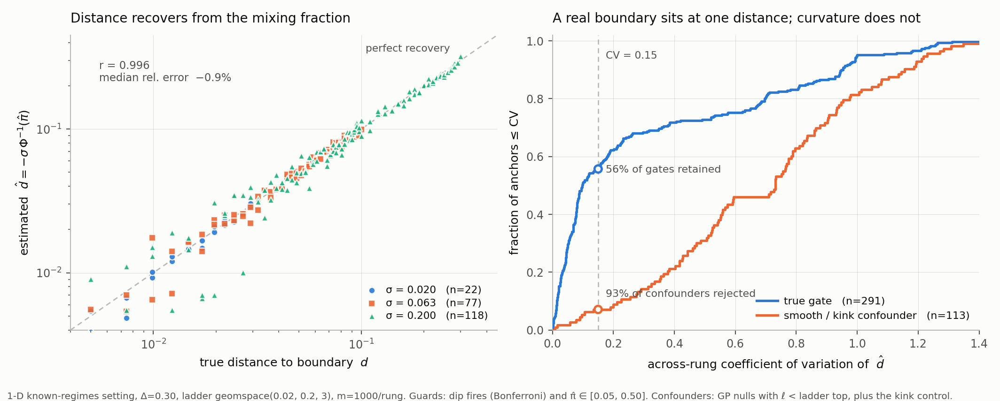
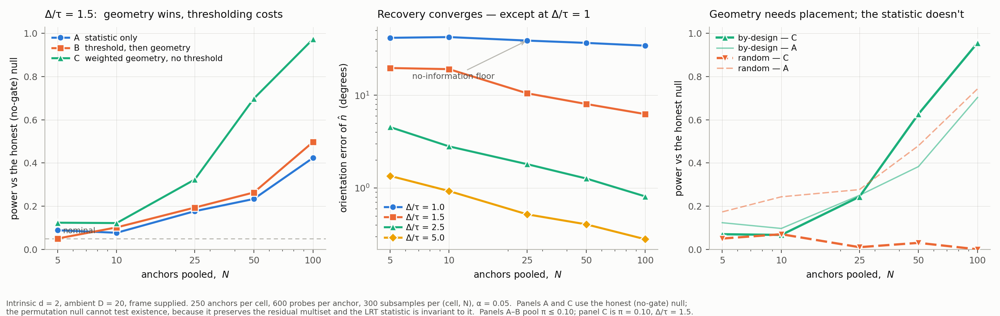
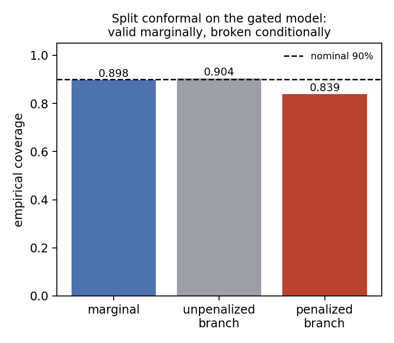

# Bump Detection

**Auditing a black-box model for a hidden shift in its behavior, from query access alone.**

Robert Romani · MIT undergraduate research · October 2026

> **About this repository.** This is a public overview of research that is unpublished and
> under active development at MIT, being prepared for publication with my advisor. It shows
> the problem, the approach, and selected validated results. **The implementation, method
> notes, derivations, and experiment code are deliberately withheld** (see
> [What is withheld](#what-is-withheld-and-why)). I'm glad to walk through any of it live.

---

## The problem

A deployed model can quietly treat one region of its input space differently. For example, it
can dock every prediction for a certain group by a fixed amount:

```
f(x) = h(x) − Δ · 1[ x falls in region S ]
```

An outside auditor sees inputs and outputs only. They have no weights, no gradients, no
routing logs, and **no label saying which branch any query took.** Existing tools can flag that
something looks off. This project asks for more: **where does the behavior change, by how
much, and how sure can we be?** The target is a statement like

> *The model shifts on feature i at threshold t̂ = 4.98 ± 0.07, recovered from N query
> anchors, p < 0.05 against a calibrated null.*

That makes this an inverse problem, not just a test.

## The approach, at a high level

1. **Probe around real inputs.** Query small perturbations around an observed data point (an
   *anchor*) and look at the distribution of responses.
2. **Read the split.** Near a hidden boundary, some probes cross it and come back shifted, so the
   responses split into two clumps instead of one smooth spread. *How many* probes crossed
   gives the distance to the boundary. *Where* the crossers sit gives its orientation.
3. **Guard against look-alikes.** Ordinary curvature can also produce two clumps. Several
   checks separate a real boundary from a curved but honest model.
4. **Pool across anchors.** Many noisy local estimates combine into one boundary, with a
   calibrated interval.

Route membership is never observed at any stage. That's the main difference from standard
boundary estimation, which assumes labels.

## Selected results

All results below are on **planted** shifts, where the truth is known. Simulations use
synthetic models. The conformal result uses real data with a planted penalty.

### 1. Distance to the boundary is recoverable from query responses alone



- On anchors where the detector fires, the estimated distance tracks the true distance with
  **r = 0.996** (median relative error −0.9%, n = 217, three probe scales spanning 10×).
  The estimate is conditioned on detection, so it doesn't cover anchors the detector misses.
- **Right panel:** a real boundary gives the same distance at every probe scale, and curvature
  doesn't. A consistency cut keeps 56% of true boundary anchors and rejects 93% of
  smooth or kinked confounders.

### 2. Pooling recovers the boundary, but only if you choose where to look



- **Orientation error shrinks as anchors are pooled.** With 100 anchors, mean error is about
  6° at signal-to-noise Δ/τ = 1.5 and under 1° at Δ/τ = 2.5. At Δ/τ = 1 there is effectively
  no orientation information.
- **Anchor placement is decisive** (right panel). With anchors placed near the boundary,
  geometric pooling reaches power 0.96 at 100 anchors. With randomly placed anchors, the
  same method drops to **0.00**. Where an auditor chooses to query matters as much as how
  many queries they make. This motivates the theory direction below.
- Which pooling rule is best depends on the setting. Geometric pooling wins at the operating
  point shown but not uniformly.

### 3. A model can be calibrated on average and miscalibrated where it matters



The data is real: Seattle building energy use (n = 3,581 buildings). The model gets a planted
penalty on buildings in census tracts with a ≥25% Black/Latino population share. Split-conformal
intervals at nominal 90% reach **0.898 coverage overall** but only **0.84 on the penalized
group.** The penalty is small next to the model's own noise, so an aggregate calibration
check sees nothing wrong.

This is a known property of marginal conformal guarantees. The point here is that the
group where coverage breaks is exactly the hidden region the audit is built to recover. On
the same data, the local detector flagged 21% of buildings under the gated model, mostly near
the boundary, and **zero of 3,420 buildings** under the honest model.

## Current limitations

- **Every result is on planted shifts**, in simulation or with a penalty planted into real data.
  The full pipeline has not yet run end-to-end against an adversarially built model.
- The probe radius and coordinate frame are supplied by hand. Choosing them automatically is
  specified but not implemented.
- Anchor selection is by design. A screening step that finds good anchors from scratch is the
  main missing piece, and result 2 shows why it matters.
- The model is a single hidden region with a constant shift. Gradual or proportional shifts are
  open.

## Where this is going

The empirical results raise a statistical question I'm now working on: **what is the smallest
hidden shift any audit can detect from a given number of queries, and how much does choosing
queries adaptively help over a fixed design?** The goal is to apply the answer to settings
where distribution shift is the core risk, such as LLMs and financial systems.

## What is withheld, and why

This is active, unpublished MIT research, so the following are kept private until publication:

| Withheld | Why |
|---|---|
| Estimator, detector, and pooling implementation | Core method; unpublished |
| Method notes, derivations, and proofs | In preparation for publication |
| Experiment code, pre-registrations, and full result tables | Tied to the unpublished method |
| Theory results on detection limits and adaptive querying | Ongoing work |

The figures and numbers above come from the private repository and are reported as measured,
with the conditions they hold under. **I'm happy to walk through the method, code, and full
results in a conversation.**

---

© 2026 Robert Romani. All rights reserved. Shared for evaluation purposes; please don't
redistribute the figures or results.
